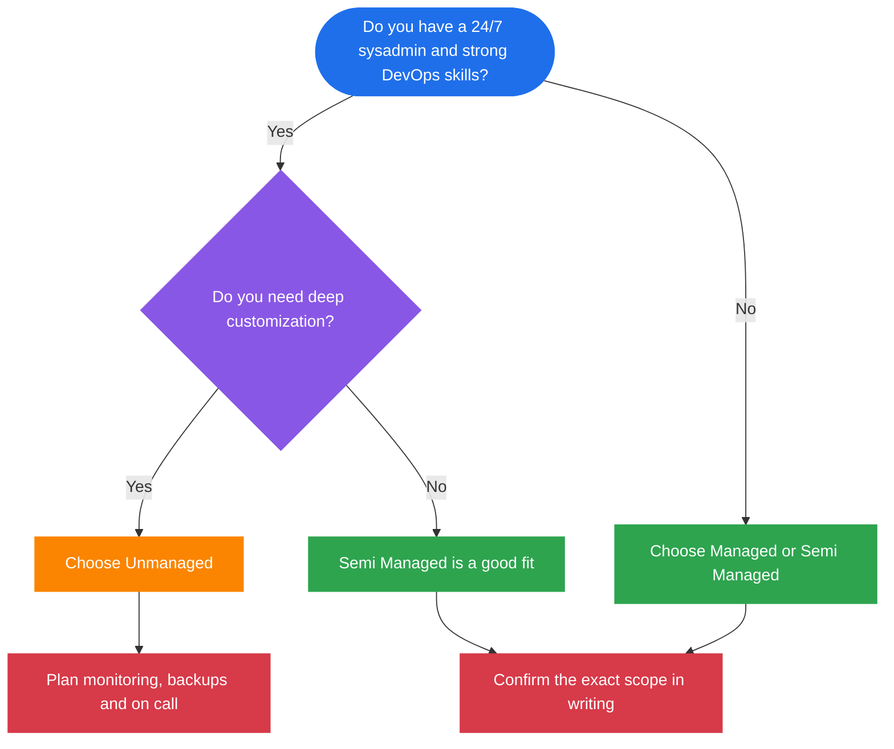

<h1>⚡ Managed vs Unmanaged iGaming Dedicated Server: Which One Fits Your Site?</h1>
 

<b>The honest 2026 guide for casino, sportsbook and poker operators</b>

 
**🎰 Casinos · 🏟️ Sportsbooks · 🃏 Poker Rooms · 🎥 Live Dealer Platforms**
 

 
> [!TIP]
> **⚡ TL;DR**
>
> 🟢 **Unmanaged** means you get the hardware and network, and you run everything else. It is lower in cost and full of freedom, but it needs a skilled team.
>
> 🔵 **Managed** means a provider or partner team looks after patching, monitoring, backups and support. It costs more, but it protects lean teams.
>
> 🟣 **Hybrid** setups sit in the middle, and many operators end up there.
>
> The right choice depends on **who responds at 3 AM**, not only on price.
 
---
 
## 📑 Table of Contents
 
| # | Section |
|---|---------|
| 1 | [🎯 Why This Question Matters](#why) |
| 2 | [🧠 What Kind of Server Does an iGaming Site Really Need?](#needs) |
| 3 | [🟢 What Is an Unmanaged iGaming Dedicated Server?](#unmanaged) |
| 4 | [🔵 What Is a Managed iGaming Dedicated Server?](#managed) |
| 5 | [⚖️ Side by Side Comparison](#compare) |
| 6 | [💰 The Real Cost](#cost) |
| 7 | [🛡️ Security and Compliance: Who Is Responsible?](#security) |
| 8 | [🧭 Which Option Fits Your Site?](#decide) |
| 9 | [🟣 The Middle Path: Semi Managed and Hybrid Setups](#hybrid) |
| 10 | [⚠️ Common Mistakes](#mistakes) |
| 11 | [❓ Questions to Ask Any Provider](#ask) |
| 12 | [🏆 Why QloudHost Is a Best iGaming Dedicated Server Provider](#qloudhost) |
| 13 | [💬 FAQs](#faqs) |
| 14 | [🏁 Conclusion](#conclusion) |
 
---
 

 
## 🎯 Why This Question Matters
 
> *It is the moment every operator fears, and it is exactly where the managed vs unmanaged choice shows its true value. Here is a quick scenario.*
 
> 🕘 **9:47 PM. Big match night.**
> Your sportsbook traffic has just tripled in ten minutes. Bets are pouring in, wallets are updating, and then the database starts to slow down.
 
**Who gets the alert?** Who logs in, finds the problem, and fixes it before players start leaving?
 
If your honest answer is *"I am not sure"*, you are standing right in the middle of the managed vs unmanaged debate.
 
In iGaming, downtime is never just a technical issue. It means lost bets, angry players, a flood of support tickets, and a dent in trust that can take months to repair. So the real question is not only **which server you buy**. It is also **who looks after that server once it goes live**.
 
| | 🟢 Unmanaged | 🔵 Managed |
|---|---|---|
| **In one line** | Powerful hardware and a fast network, and you run everything else | The same hardware plus a team that helps with OS, security, monitoring and backups |
 
Both can power a successful casino, sportsbook, or poker platform. The right choice depends on your team, your budget, and how much risk you are ready to carry.
 
In this guide, you will learn what iGaming platforms really need from a server, how both setups work, what each costs in the real world, and how to decide with confidence.
 
---
 

 
## 🧠 What Kind of Server Does an iGaming Site Really Need?
 
> *Before comparing managed and unmanaged, it helps to understand the workload. An iGaming platform behaves very differently from a normal website, and that shapes every hosting decision you make.*
 
| Need | Why It Matters | What It Means for Your Server |
|---|---|---|
| ⏱️ **Always on** | Players do not wait for business hours. A casino lobby is busy at 3 AM. | Reliable power, network and constant monitoring |
| 💰 **Real money** | Every bet, deposit and withdrawal touches your database. | Fast, accurate and consistent performance |
| 📈 **Traffic spikes** | Tournaments, jackpots and promotions can multiply traffic in minutes. | Headroom and predictable performance, not shared resources |
| 🔌 **Many integrations** | Game providers, payment gateways and live studios all depend on quick responses. | Low latency and stable connections |
| 🎯 **Constant attacks** | Betting sites attract DDoS, bots, credential stuffing and fraud attempts. | Strong security from day one |
| 📋 **Regulators** | Licensed operators may need proof of access control, logging, patching and backups. | Clean records and well run processes |
 
> [!NOTE]
> Licensing and compliance rules vary by jurisdiction. Always confirm them with your legal or compliance advisor.
 
### 🖥️ Why Dedicated Servers Are the Starting Point
 
Because of all this, most serious operators choose a **dedicated server**. It is single tenant, which means the whole machine belongs to you. You get consistent performance, no noisy neighbors, and full isolation for sensitive data.
 
### 🤔 So Where Does Management Come In?
 
A dedicated server only answers the **hardware** question. The next question is about **people and process**: who installs updates, watches dashboards, fixes problems and responds to attacks?
 
Neither option is better for everyone. It depends on the skills you have in house, the budget you can commit, and how much operational risk your business can handle.
 
---
 

 
## 🟢 What Is an Unmanaged iGaming Dedicated Server?
 
> *An unmanaged server is the do it yourself route. The provider gives you the machine, and you take care of almost everything that runs on it.*
 
### 🧩 Who Does What?
 
| 🏢 Provider Usually Handles | 🧑‍💻 You Handle |
|---|---|
| ✅ Physical hardware ✅ Data center power and cooling ✅ Network connection ✅ Replacing failed parts | 🔧 OS install and configuration 🔧 Firewalls and security hardening 🔧 Patches and updates 🔧 Monitoring and alerts 🔧 Backups and restore tests 🔧 Database and web stack tuning 🔧 Incident and attack response 🔧 Scaling and growth planning |
 
### ⚔️ Pros and Cons
 
| 🟢 Advantages | 🔴 Drawbacks |
|---|---|
| **Full control.** You choose the OS, stack, security tools and configuration. | **Skilled people required.** You need a Linux admin, a database specialist and security know how. |
| **Lower monthly cost.** You pay for server and bandwidth, not for management services. | **You own every mistake.** A missed patch or wrong firewall rule is your problem. |
| **Flexibility to optimize.** Tune the kernel, database and network to squeeze out performance. | **On call pressure.** Someone must respond at any hour, and small teams burn out fast. |
| **No vendor lock in.** Because you control the setup, moving providers is usually simpler. | **Hidden staffing costs.** Salaries, contractors and tools add up quickly. |
 
> [!IMPORTANT]
> **🎯 Best for:** established operators with in house DevOps and security teams, technical founders who enjoy running their own stack, and platforms with highly customized setups.
 
---
 

 
## 🔵 What Is a Managed iGaming Dedicated Server?
 
> *A managed server is the supported route. A provider, or a partner team, takes over many of the daily operational tasks so your people can focus on the business.*
 
The exact scope depends on the provider, because **"managed" is not a standard label**. Typical services include:
 
- 🛠️ Operating system setup and regular updates
- 🔒 Security patching and firewall management
- 📡 Server monitoring with alerts
- 💾 Backup setup and restore support
- 📊 Performance checks and basic tuning
- 🚨 Incident response and technical support
- 🗄️ In some cases, database or control panel management
### ⚔️ Pros and Cons
 
| 🟢 Advantages | 🔴 Drawbacks |
|---|---|
| **Smaller team needed.** No need to hire a full infrastructure team just to keep the lights on. | **Higher cost.** Management is a service, and it adds to the monthly bill. |
| **Faster response.** Experts are watching, so problems are often fixed before players notice. | **Less freedom.** Some plans limit root access, software choices or custom configurations. |
| **Built in expertise.** You benefit from experience gained running many servers under pressure. | **Scope confusion.** Many providers manage the server but not your application. |
| **Predictable operations.** Patching and backups follow a process, which reduces human error. | **Provider dependence.** Your uptime now depends partly on their response quality. |
 
> [!IMPORTANT]
> **🎯 Best for:** new operators with small technical teams, businesses that want predictable operations, and platforms where one hour of downtime costs more than months of management fees.
 
---
 

 
## ⚖️ Managed vs Unmanaged iGaming Dedicated Server: Side by Side
 
> *Sometimes the easiest way to decide is to see everything in one place. This table compares both options across the factors that matter most for iGaming platforms.*
 
| Factor | 🟢 Unmanaged | 🔵 Managed |
|---|---|---|
| 💵 **Monthly cost** | 🟢 Lower server fee | 🟡 Higher, includes management |
| 🎛️ **Control** | 🟢 Full control over everything | 🟡 Sometimes limited access |
| 👥 **Technical team needed** | 🔴 Strong in house skills required | 🟢 Smaller team is enough |
| 📡 **Monitoring** | 🔴 You set it up and watch it | 🟢 Provider watches and alerts |
| 🔒 **Security patching** | 🔴 Your responsibility | 🟢 Usually handled for you |
| 💾 **Backups** | 🟡 You configure and test | 🟢 Often set up and supported |
| 🚨 **Incident response** | 🔴 Your team on call | 🟢 Provider team helps |
| 🧩 **Customization** | 🟢 Unlimited | 🟡 Depends on plan rules |
| ⚡ **Recovery speed** | 🟡 Depends on your team | 🟢 Usually faster with support |
| 🏅 **Best for** | 🔵 Experienced technical teams | 🔵 Lean teams that want support |
 
**Legend:** 🟢 Strong point · 🟡 Depends · 🔴 Needs your attention
 
---
 

 
## 💰 The Real Cost: What Are You Actually Paying For?
 
> *Price is often the first thing people compare, but the sticker price can be misleading. A fair comparison looks at the total cost of running the server, not just the monthly invoice.*
 
| Cost Item | 🟢 Unmanaged | 🔵 Managed |
|---|---|---|
| 🖥️ Server and bandwidth | Yes | Yes |
| 🛠️ Management service fee | None | Added on top or included in plan |
| 👨‍💻 Sysadmin salary or contractor | Usually needed | Reduced |
| 📡 Monitoring and logging tools | You buy and set up | Often provided |
| 💾 Backup storage and tools | You arrange | Often supported |
| 🛡️ Security tools and audits | You arrange | Partly covered |
| 🔥 Cost of downtime | Depends on your team | Lower with fast response |
 
> [!NOTE]
> **🧮 Simple illustration (numbers will differ for you):** Imagine a server that costs $500 per month. A managed plan adds a service fee on top. An unmanaged plan skips the fee, but you may need a part time engineer, a contractor, monitoring software, backup storage and security tools. Add those up, and the unmanaged option can end up costing more than the managed one.
 
**The cost that matters most is downtime.** On a busy platform, a single bad hour can easily cost more than several months of management fees. Cheap is only cheap until something breaks.
 
On the other side, if you already have an experienced team on payroll, paying for management you do not need is wasted money. The best option matches the skills you already have.
 
---
 

 
## 🛡️ Security and Compliance: Who Is Responsible for What?
 
> *Security is where the managed vs unmanaged choice has the biggest consequences. Think of it as a shared responsibility, where some parts belong to the provider and some always stay with you.*
 
| Security Task | 🟢 Unmanaged | 🔵 Managed |
|---|---|---|
| OS hardening and firewall rules | 🧑‍💻 You | 🏢 Usually provider |
| Security patching | 🧑‍💻 You | 🏢 Usually provider |
| Monitoring and alerts | 🧑‍💻 You | 🏢 Usually provider |
| Application code and admin accounts | 🧑‍💻 You | 🧑‍💻 You |
| Player data handling | 🧑‍💻 You | 🧑‍💻 You |
| Team access control | 🧑‍💻 You | 🧑‍💻 You |
| License and legal duties | 🧑‍💻 You | 🧑‍💻 You, with possible help on records |
 
> [!WARNING]
> **🌊 DDoS protection needs layers.** Hardware level protection at the network edge is a strong foundation, but large operators often add extra layers such as traffic filtering, rate limiting and upstream mitigation. Ask your provider exactly what is included and what is not.
 
> [!CAUTION]
> **📋 Compliance stays with you.** Regulators and auditors may ask for evidence of patching, logging, backups and access control. A managed provider can help you keep these records, but accountability stays with the license holder. Always confirm the rules for your jurisdiction.
 
---
 

 
## 🧭 Which Option Fits Your Site? A Practical Decision Guide
 
> *There is no single winner, so the best approach is to match the option to your situation. Use the scenarios, questions and flowchart below to find your fit.*
 
### 🎬 Common Scenarios
 
| Your Situation | Best Fit |
|---|---|
| 🆕 **New online casino with a small team.** You are building games, marketing and payments at once. | 🔵 Managed or semi managed |
| 📈 **Growing platform with one part time sysadmin.** Busy platform, stretched technical team. | 🔵 Managed support or a support add on |
| 🏢 **Established operator with in house DevOps and security.** You have the people and processes. | 🟢 Unmanaged |
| 🏟️ **Sportsbook with heavy seasonal peaks.** Traffic jumps during major tournaments. | 🟣 Strong in house team or fast provider response |
| 🪙 **Crypto casino with a lean tech team.** Speed of launch and privacy matter. | 🟣 Flexible provider with crypto payments and a support level you choose |
 
### ✋ Five Questions to Ask Yourself
 
1. 🕒 **Who responds at 3 AM?** If the answer is nobody, you need managed support.
2. 🧠 **Do we have the skills?** Linux administration, database tuning, networking and security are all required for unmanaged.
3. 💸 **What does an hour of downtime cost us?** If the number is high, the case for managed support is strong.
4. 🎛️ **How much customization do we need?** Deep control fits unmanaged or semi managed better.
5. 📋 **What are our compliance duties?** If you need documented processes and records, managed support can help.
### 🗺️ Quick Decision Flowchart
 

 
---
 

 
## 🟣 The Middle Path: Semi Managed and Hybrid Setups
 
> *It is not always a choice between two extremes. Many iGaming operators land somewhere in the middle, and that is often the smartest option.*
 
| Model | How It Works | Good For |
|---|---|---|
| 🟣 **Semi managed** | The provider handles the basics such as OS, monitoring and updates. Your team manages the application and database. | Teams with app skills but limited server skills |
| 🤝 **Unmanaged plus a support partner** | You rent an unmanaged server and hire a third party team for monitoring, security or emergency response. | Teams that want freedom plus a safety net |
| 🌱 **Start managed, move to unmanaged later** | Begin with managed support, then bring operations in house as your team grows. | New operators planning to scale |
 
> [!TIP]
> Be honest about what your team can do **today**, not what you hope it can do in a year. Also choose a provider that makes migration easy so you never feel trapped.
 
---
 

 
## ⚠️ Common Mistakes When Choosing Between Managed and Unmanaged
 
> *Most problems come from wrong assumptions, not wrong servers. Avoid these mistakes and you will already be ahead.*
 

<b>🚫 Click to see the 7 most common mistakes</b>

 
1. ❌ **Assuming unmanaged is always cheaper.** Once you count staff time and downtime risk, it often is not.
2. ❌ **Assuming managed means zero responsibility.** You still own your application, your data and your compliance.
3. ❌ **Ignoring the fine print.** Always read exactly what the provider manages and what it does not.
4. ❌ **Overlooking response times.** A support promise is only useful if the response is fast enough for your business.
5. ❌ **Skipping backup tests.** A backup that has never been restored is only a hope, not a plan.
6. ❌ **Choosing on price alone.** The cheapest plan is rarely the best for a platform that handles real money.
7. ❌ **Forgetting the exit plan.** Make sure you can migrate away without a painful rebuild.

---
 

 
## ❓ Questions to Ask Any Provider Before You Sign
 
> *A short conversation with a provider can save you from expensive surprises. These questions will quickly show whether a provider is right for your platform.*
 

<b>📝 Click to open the provider checklist</b>

 
- [ ] What exactly is included in the management service, and what is excluded?
- [ ] Do I get full root access, and are there any software restrictions?
- [ ] How fast is your support response for urgent issues?
- [ ] What DDoS protection is included, and how is attack traffic handled?
- [ ] How are backups handled, and who tests the restores?
- [ ] Can you help migrate my existing platform?
- [ ] What network speeds and bandwidth options are available?
- [ ] What data center tier and location do you use?
- [ ] Which payment methods do you accept, including crypto?
- [ ] How easily can I upgrade, downgrade or change my support level later?

---
 

 
## 🏆 Why QloudHost Is a Best iGaming Dedicated Server Provider
 
> *Whichever management style you choose, the quality of the server underneath decides how far you can go. This is where QloudHost makes a strong case for iGaming operators.*
 
**QloudHost iGaming Dedicated Servers** are built for online casinos, sportsbooks, poker rooms and other gaming platforms. Here is what stands out:
 
| | Feature | Details |
|---|---|---|
| 🖥️ | **Single tenant servers** | AMD EPYC, AMD Ryzen and Intel Xeon options, so you never compete with other customers for resources |
| 🏢 | **Tier III data center** | Located in Amsterdam, Netherlands, a major European internet hub |
| 💵 | **Plans for every stage** | From $105.99 per month up to a 96 core AMD EPYC 9655P server at $1664.99 per month |
| 🚀 | **Up to 10 Gbps ports** | Built for traffic spikes and live streaming workloads |
| 🛡️ | **Hardware level DDoS protection** | Helps keep your platform online during attacks |
| 🪙 | **USDT and crypto payments** | For operators who prefer them |
| 🎁 | **Zero setup fees** | Start without extra upfront charges |
| 🚚 | **Free migration** | Makes moving an existing platform much easier |
 
### 🔗 How This Connects to Managed vs Unmanaged
 
- 🟢 If your team has strong technical skills, QloudHost gives you a **powerful, transparent foundation** to run your own stack.
- 🔵 If you want extra support, **talk to the QloudHost team** about the level of help that suits your platform before you order.
- 🚚 Free migration also lowers one of the biggest worries when switching providers or moving from one management style to another.

 

> [!NOTE]
> Prices and plans can change, so always check the latest details on the [QloudHost iGaming Dedicated Servers page](https://qloudhost.com/igaming-dedicated-servers). Also make sure your project follows the licensing and legal rules of the places where you operate.
 
---
 

 
## 💬 FAQs
 
> *Here are quick answers to the questions operators ask most often when choosing between managed and unmanaged servers. Click any question to open its answer.*
 

<b>🔹 What is the main difference between managed and unmanaged iGaming dedicated servers?</b>

 
With an unmanaged server, you handle the operating system, security, updates and monitoring yourself. With a managed server, the provider or a partner team handles many of those tasks for you. The hardware is the same, but the workload on your team is very different.
 

<b>🔹 Is an unmanaged server cheaper for an iGaming site?</b>

 
The monthly server fee is usually lower, but the total cost can be higher once you add staff, tools and downtime risk. It is cheaper only if you already have the skills in house. Always compare the full cost, not just the invoice.
 

<b>🔹 Do I still need a technical person if I choose a managed server?</b>

 
Yes, in most cases. Managed services usually cover the server, not your application, game integrations or business logic. A small technical team or a trusted contractor is still very helpful.
 

<b>🔹 Which option is better for a new online casino?</b>

 
A new casino with a small team often does better with managed or semi managed support. It reduces the risk of server mistakes while you focus on growth. You can always bring operations in house later.
 

<b>🔹 Can I switch from unmanaged to managed later, or the other way around?</b>

 
Usually yes, but it is easier with a provider that offers migration help. Plan the switch carefully, back up everything and test before moving live traffic. This flexibility is a good reason to choose your provider wisely.
 

<b>🔹 Does the choice affect compliance with gaming licenses?</b>

 
It can affect how easily you gather proof of patching, logging and backups. A managed provider may help with records, but accountability stays with you as the license holder. Always check the requirements for your jurisdiction.
 

<b>🔹 Why do iGaming sites use dedicated servers instead of shared hosting or a VPS?</b>

 
Real money platforms need consistent speed, strong isolation and room to handle sudden spikes. A dedicated server gives you all of this because no one else shares your hardware. That makes it the preferred base for serious casinos and sportsbooks.
 

---
 

 
## 🏁 Conclusion
 
> *Choosing between managed and unmanaged is really a question about people, not just technology. Here is the short version of everything above.*
 
| | Verdict |
|---|---|
| 🟢 **Unmanaged** | Freedom and lower fees, but it demands skilled hands and constant attention |
| 🔵 **Managed** | Support and peace of mind, but it costs more and may limit your control |
| 🟣 **Hybrid** | A smart middle path for teams that are growing |
 
The smartest operators are honest about what their team can do today. If you have strong in house skills, unmanaged can be a powerful and efficient choice. If your team is lean or your downtime cost is high, managed or semi managed support is a safer path. And if you are somewhere in between, a hybrid setup can give you the best of both.
 
> [!IMPORTANT]
> **💡 Bottom line:** Whatever you choose, start with a strong foundation. **QloudHost** offers single tenant AMD EPYC, Ryzen and Intel Xeon servers in a Tier III Amsterdam data center, with up to 10 Gbps ports, hardware level DDoS protection, crypto payments, zero setup fees and free migration.
 

 
### ⭐ Found this guide useful? Star the repo and share it with another operator.
 

